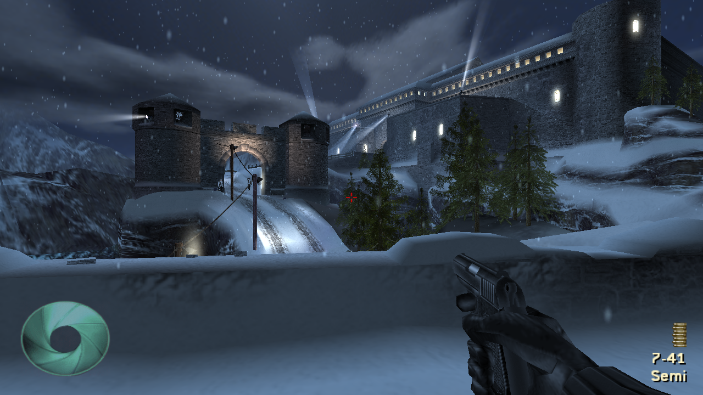
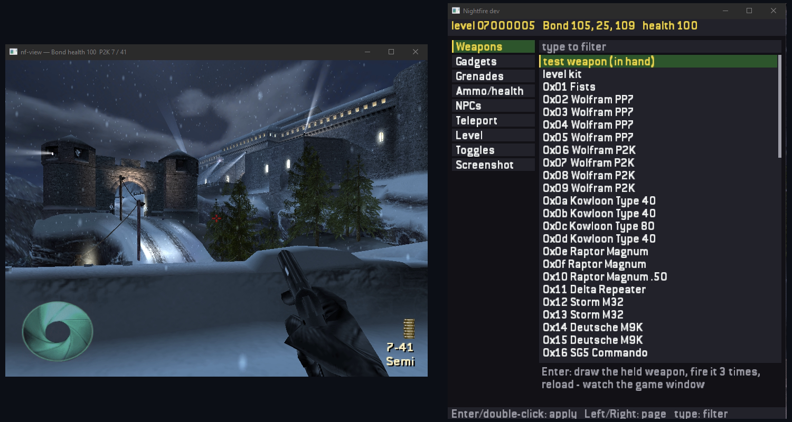
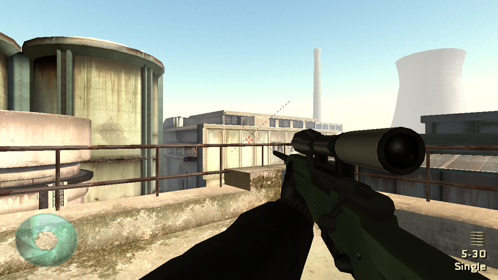
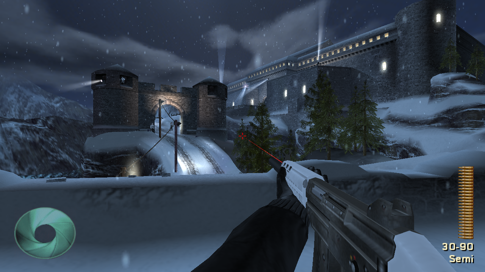
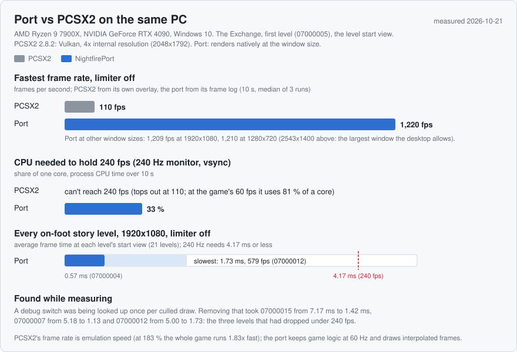
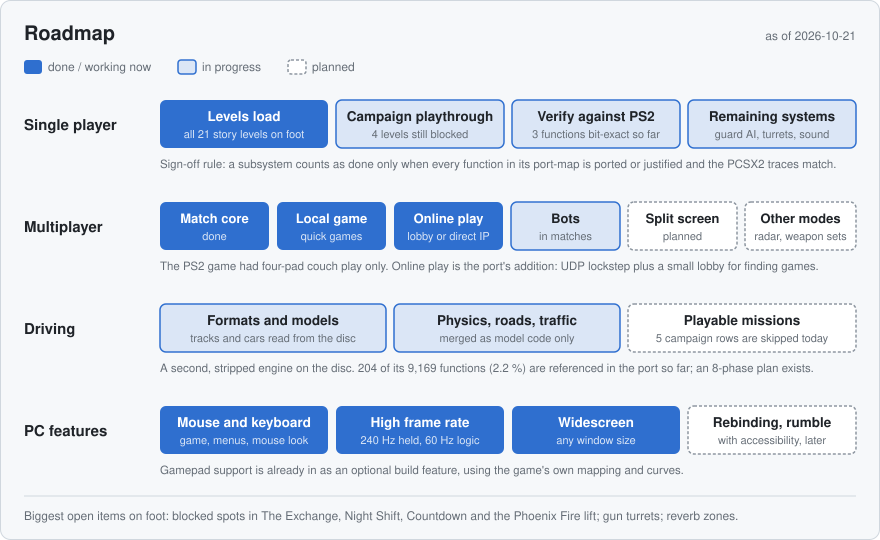
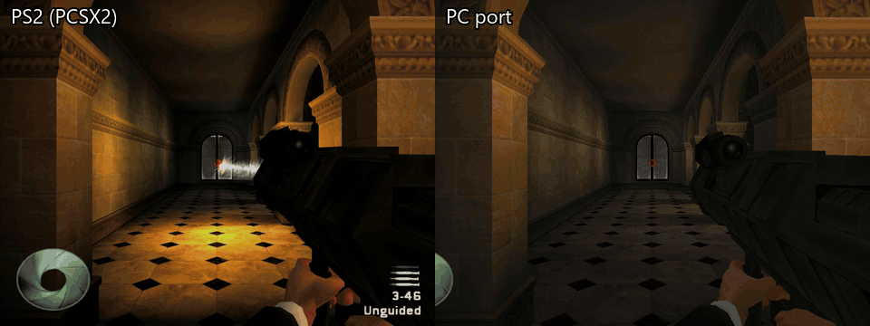

# Nightfire Rust

> [!WARNING]
> ## This port is not finished.
> Nightfire Rust is a work in progress. Expect bugs, missing features, and levels that don't yet play like the original. The driving missions can't be played yet. If you hit a problem, press **F10** in game (or **Report crash** in the launcher) to send a report.

Nightfire Rust is a native Windows PC port of 007: Nightfire (PS2), written in Rust. This 007 Nightfire port is rebuilt from the game's own data and logic (the PlayStation 2 release, NTSC-U SLUS-20579), runs natively on Windows with no emulator, and treats mouse and keyboard as first-class input. The repository is named NightfirePort.



## What this is, and isn't

- It is a port. The game's behaviour is re-implemented in Rust, using a Ghidra decompile of the disc's executables as the reference for what the original code does.
- It is not an emulator and not a static recompiler. No PS2 code runs.
- You need your own disc. The port reads your disc image at run time (picked in the launcher, or `NF_ISO` / a path on the command line). No game files are in this repository, and nothing the tools extract is committed.
- The 2002 PC "Nightfire" is a different game (Gearbox, GoldSrc) and is not involved.

The disc holds two engines: `ACTION.ELF` (Eurocom's on-foot engine; shipped unstripped with 3,038 functions and 5,603 symbols) and `DRIVING.ELF` (EA's EAGL-based driving engine, stripped). The on-foot engine is where almost all of the work has gone so far.

## Status at a glance


In short:

- **On foot:** all 27 on-foot archives on the disc load and run. Not every level can be finished yet. The walkthrough tests that drive Bond through the same input a player uses still stop on seven levels (07000005, 07000006, 0700000a, 07000014, 07000016, 0700001b, 0700004a), and other levels have known problems. Each level's page in `docs/levels/` lists them.
- **Driving:** the five driving missions can't be played. Picking one in the mission list shows a notice and unlocks the next mission. Parts of the driving engine exist as model code only: vehicle physics, the road network, AI traffic, input mapping, HUD data and mission scripts.
- **Front end:** it follows the game's own menu flow. With the `movies` feature, the disc's videos play where the game plays them: the boot logos, the intro, the menu backdrops, and each mission's briefing and outro.
- **Multiplayer:** the game's on-foot match rules and modes run on the 8 arenas, with bots, on one screen. There is no split screen. Online play is new in the port (see below).
- **Cut-scenes:** faces animate from the game's own morph data.

"Cited" in the graphic is deliberately a loose measure. It counts a function whose address or name appears anywhere in the Rust crates or the docs. The port-map documents hold the stricter per-function grade (ported, partial, stub, stand-in, not started). The verification ledger lists three functions proven bit-exact against recorded PCSX2 calls (`PS2Sinf`, `Quat_QuatToMat`, `Rand_Rand`, 40 of 40 each).

## What the port adds over the PS2 version

Everything below is on top of the game as it shipped. The game's own controller mapping, auto-aim and secret codes are still there.

**High frame rate.** The simulation stays at the game's fixed 60 Hz. Rendering interpolates the camera and skin palettes between ticks, so the frame rate is whatever the hardware allows (`--fps N` caps it). The original ran at 60 Hz with a 30 Hz fallback; in PCSX2 98.8 % of measured updates were at 60 Hz.

**Mouse look.** Raw mouse deltas go straight into yaw and pitch (0.0025 rad per count), with no dead zone, curve or ramp. There is no manual-aim box with a mouse. Auto-aim is the Auto Aim profile option (on by default, as in the game). The wheel switches weapons (G for gadgets) and zooms while you aim a zoomable weapon.

**Online multiplayer.** The PS2 game is four-pad couch play with no online mode. The port adds Host Online and Join Online pages over a UDP lockstep session in `nf-net`, with acks, retransmit, input delay and a per-tick state hash for desync detection. A match takes up to 16 participants, humans and bots together. To join a match you can:

- type a 4-character code;
- pick it from the public list a small lobby service keeps;
- or enter the host's IP:port.

The lobby service only introduces the players; the match itself runs between the players' own machines. UPnP / NAT-PMP port mapping, STUN and hole punching are built in.

**Widescreen and window size.** Gameplay fills the window's aspect; cut-scenes are pillar-boxed at the game's 4:3. The window can be any size.

**Keyboard and mouse menus.** Menu rows are hit-tested where they are drawn, and the hint bars name keyboard keys instead of PlayStation buttons.

**Dev tools in a separate window.** With `--dev`, a native "Nightfire dev" window opens beside the game and the game keeps running. It offers weapon and gadget lists, grenades, ammo and health, NPC spawning, teleport, level selection, toggles and screenshots. In the game window, F1 is an AI overlay and F2 brings the dev window forward.



**Rapid fire.** An optional rapid-fire toggle, off by default (`--rapid-fire`, or in the dev window).


**Smaller things.**

- A "Keep shell casings" option; the default is the game's own lifetime.
- Optional gamepad support through gilrs (a build feature, off by default), running the game's own mapping and curves.
- A launcher that updates itself from this repository's GitHub releases.

| | |
|---|---|
|  |  |
|  | |

The port's images in this README were rendered by the port at 1280x720. The left half of the comparison clip further down is a PCSX2 capture of the original game.

## Performance



Measured on one PC (Ryzen 9 7900X, RTX 4090, Windows 10) on 2026-10-21 at the start of The Exchange (level 07000005).

- **Frame limiter off:** PCSX2 2.8.2 (Vulkan, 4x internal resolution) reaches 110 fps by its own overlay. The port reaches 1,220 fps by its frame log (median of three 10-second runs at a 2543x1400 window, the largest the desktop allows; 1,209 at 1920x1080, 1,210 at 1280x720).
- **240 Hz monitor with vsync:** the port holds 240 fps on 33 % of one core. PCSX2 cannot reach 240 at all, and at the game's own 60 fps it uses 81 % of a core.

The two frame rates do not mean the same thing. PCSX2's is emulation throughput: at its "183 %" readout the whole game, logic included, runs 1.83x fast. The port keeps the game logic at a fixed 60 Hz and renders as many interpolated frames as the hardware allows, so 1,220 fps is rendered frames at normal game speed. PCSX2 is also drawing a 4x upscale of the PS2's ~512x448 frame, where the port renders natively at the window size.

### Frame time per level (2026-10-21)

Average frame time at each on-foot story level's start view, release build, a real 1920x1080 window, limiter off (one 10-second run per level after 20 seconds of warm-up). 240 Hz needs 4.17 ms or less.

| Level | Mission | Frame time |
|---|---|---|
| 07000001 | Double Cross | 0.64 ms (1,551 fps) |
| 07000002 | Double Cross | 0.74 ms (1,356 fps) |
| 07000003 | Double Cross | 0.98 ms (1,015 fps) |
| 07000004 | Double Cross | 0.57 ms (1,754 fps) |
| 07000005 | The Exchange | 0.82 ms (1,216 fps) |
| 07000006 | The Exchange | 0.91 ms (1,101 fps) |
| 07000007 | The Exchange | 1.13 ms (888 fps) |
| 07000008 | The Exchange | 0.70 ms (1,431 fps) |
| 07000009 | Night Shift | 0.67 ms (1,491 fps) |
| 0700000a | Night Shift | 0.85 ms (1,177 fps) |
| 0700000b | Night Shift | 1.22 ms (817 fps) |
| 0700000c | Chain Reaction | 1.26 ms (794 fps) |
| 0700000d | Chain Reaction | 0.83 ms (1,204 fps) |
| 07000011 | Phoenix Fire | 1.48 ms (677 fps) |
| 07000012 | Phoenix Fire | 1.73 ms (579 fps) |
| 07000013 | Phoenix Fire | 0.83 ms (1,204 fps) |
| 07000014 | Countdown | 1.46 ms (684 fps) |
| 07000015 | Countdown | 1.42 ms (702 fps) |
| 07000016 | Countdown | 1.04 ms (962 fps) |
| 0700001b | Equinox | 0.59 ms (1,687 fps) |
| 0700004a | Phoenix Fire | 1.62 ms (619 fps) |

The slowest level is 07000012 at 1.73 ms (579 fps). Measuring this table found a regression: a debug switch was being read once for every culled draw, which had pushed 07000007, 07000012 and 07000015 to 5.0-7.2 ms (140-200 fps). It is fixed, and the per-frame cost test (`frame_cost_live`) now also budgets the render encode on every single-player archive.

## Roadmap



The on-foot side follows the plan's rule of porting one subsystem whole at a time: core loop, player, weapons, guards (268 functions), objects and levels, then rendering. A subsystem is done when every function in its port-map is ported or justified and the recorded PCSX2 traces match.

Multiplayer has the match core, local and online games, and bots in matches. Split screen is not implemented. The remaining bot behaviours, radar, panes and weapon sets are still open.

The driving engine has its own phased plan (`docs/atlas/driving.md`) and is the furthest out. A later polish phase lists FOV, a rebinding UI, rumble and accessibility.

Long-term guardrails from the plan:

- determinism: a shared bit-exact RNG and a fixed 60 Hz tick;
- players kept as a list, so co-op is possible later;
- the game's own multiplayer first;
- the port's data structures as a future mod format.

## Building and running

Windows builds are published on this repository's Releases page: a single `NightfirePort.exe` (the launcher, which updates itself). You need your own NTSC-U disc image (v1.00).

To build from source you need a Rust toolchain:

```
cargo run --release --offline -p nf-view --features movies -- "<path to iso>" 07000005
```

`nf-view [<iso>] <level> [--all] [--seq K] [--frame F] [--fire] [--reinforcements] [--shot out.png ...]`. Without `<iso>` the path comes from `NF_ISO`. Without a level, the game boots to its title screen. `--shot` renders one 1280x720 frame headless and exits.

Controls:

| Key | Action |
|---|---|
| W A S D | move |
| mouse | look |
| left click | fire |
| right click | aim / zoom |
| B | alternate fire mode |
| R | reload |
| Space | jump |
| C or Ctrl | crouch |
| E | use |
| wheel or Q | cycle weapons |
| 1, 2, 3 | pick a weapon |
| G | cycle gadgets |
| Esc | pause |
| F10 | bug report |
| F12 | screenshot |

Optional cargo features:

- `gamepad`: gilrs, off by default.
- `movies`: the MPEG-2 decoder for the disc's videos. It is off by default to keep plain builds light, but without it no movie plays, so build with `--features movies` to play the game as shipped.

Tests read the disc only when `NF_ISO` is set and are silent (`NF_SILENT=1`):

```
NF_ISO="<path to iso>" cargo test --offline --release -- --test-threads=1
```

The workspace has six crates:

- `nf-formats`: on-disc format readers.
- `nf-game`: the fixed-tick simulation ported from `ACTION.ELF`, plus the driving model code.
- `nf-view`: window, renderer, menus and launcher; the playable app.
- `nf-audio`: SPU voices mixed in software, played through cpal.
- `nf-net`: the UDP lockstep session, join codes and the lobby client.
- `nf-extract`: a CLI for inspecting your disc: `info`, `manifest`, `elfs`, `files-extract`, `tex-export`, `bigf-extract`, `weapon-matrix`, ... (57 commands).

That is about 300,000 lines of Rust in total.

## Legal

This project is not affiliated with, endorsed by or connected to the rights holders of *007: Nightfire* or James Bond, nor with the original game's developers or publisher. You must own the game and supply your own disc image.

Apart from the screenshots and clips on this page, the repository contains no game data. Golden test snapshots hold numbers, hashes and identifiers only. The research material (decompiles, ELFs, emulator snapshots) lives in a git-ignored directory and is never uploaded.

Code reused from the rerac project (a Rust port of Ratchet & Clank 1, which served as the model for this one) is under its ISC licence; see `THIRD_PARTY_RERAC_LICENSE.txt`. Code ported from OpenGOAL (the Jak & Daxter decompilation project; its SPU ADPCM decoder variant lives in `crates/nf-formats/src/vag.rs`) keeps its ISC licence notice in `THIRD_PARTY_OPENGOAL_LICENSE.txt`.

## How the work is verified

Visual work is checked against the real game side by side: the same scene rendered by the port and captured from PCSX2 at the same spot and timing.



Every claim in the docs carries an evidence tag:

- **[M]** from the machine code;
- **[D]** from the disc data;
- **[L]** from a live PCSX2 snapshot;
- **[S]** suggested (not yet backed by evidence).

Behaviour is checked against the original by recording PCSX2 calls and traces and comparing numbers, not images, so no game data ends up in the tests. The verification ledger lists what is proven bit-exact.

The test suite has about 3,400 `#[test]` functions across 735 integration test files. The last full run on master (2026-10-22) was 3,190 passed, 0 failed, 147 ignored.

- **Walkthroughs:** 26 `walk_*` and 48 `walkreal_*` test files drive the story levels headless; the `walkreal_*` ones drive Bond through the real input path.
- **Placements and archives:** every placement on all 27 story levels is checked to resolve, and all 27 on-foot archives run 600 ticks without a panic.
- **Performance:** per-frame cost budgets are part of the same suite.

Open work is tracked in a gaps list (`docs/GAPS.md`: 49 items, 23 still open or partly open) and open questions in `docs/UNKNOWNS.md` (48: 21 open, 7 partly answered).
